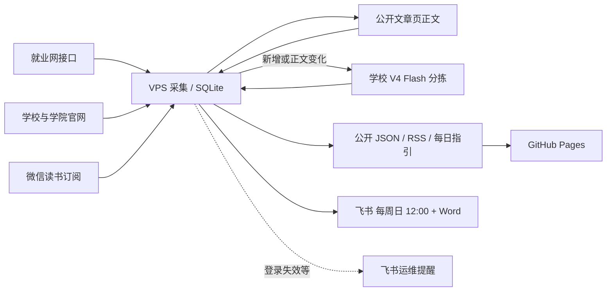

# 北理消息站 · bit-student-feed

把北理工分散的公开消息收到一处：就业网、学校与学院官网，以及各单位公众号。VPS 负责采集和保存，学校平台的 DeepSeek V4 Flash 负责分拣，结果每天发布成网页和 RSS，每周日中午 12 点在飞书群推送一周汇总，并附 Word 完整版。

这是非官方学生项目，不读取任何人电脑上的微信或聊天记录。

- 网页：<https://lankerr.github.io/bit-student-feed/>
- RSS：`feed.xml`（全部消息）、`activities.xml`（通过日期与来源核验的可参加活动）
- 每日指引：`daily.md`

## 消息从哪里来

| 来源 | 方式 | 说明 |
| --- | --- | --- |
| 北理就业网 | 公开分页接口 | 招聘、实习、宣讲会、双选会、指导活动、通知 |
| 学校与学院官网 | 31 个公开栏目 | 见 `config/official-websites.json` |
| 公众号 | 微信读书网页版订阅 | 名单见 `config/wechat-accounts.json`，按重要程度每 1～8 小时查一次 |

公众号为什么走微信读书：2026-07-30 起，公众号后台读取“其他公众号文章列表”的接口（`appmsgpublish`）对所有第三方一律返回 `200013`，等待和重试都不会恢复，wechat-article-exporter 因此停止维护，we-mp-rss 也改走微信读书。微信读书网页版目前每次只返回一个号的**最新一篇**，所以多图文推送的第二篇及以后可能看不到；就业类消息另有就业网接口兜底。

## 两个登录，怎么保持不掉

| 登录 | 用途 | 自动维护 |
| --- | --- | --- |
| 微信读书（运营者微信扫码） | 订阅公众号文章 | 与网页版客户端相同：会话过期（-2012）时用 `wr_rt` 自动续期并重放请求 |
| 公众号后台（运营者自己的公众号） | 搜索、核验公众号身份 | 每 30 分钟检查一次，访问后台首页会把登录有效期顺延 4 天 |

续期失败、即将过期、连续限流或采集停滞时，系统往飞书运维群发提醒；官网与就业网整轮采集超过 36 小时没跑，或某个来源超过两天没有成功读取（页数上限造成的“部分采集”不算），也会提醒。提醒附带服务器上的“登录维护”页面链接。在任何一台电脑的浏览器里打开它，点按钮、扫码即可恢复；页面也能通过粘贴文章链接添加新的订阅号。链接含口令，只保存在服务器私密配置和运维者本机。

## 数据怎样流动



| 定时任务（北京时间） | 做什么 |
| --- | --- |
| `bitfeed-wechat.timer` 每 5 分钟 | 微信读书订阅：每次最多 3 个请求，间隔 50～80 秒；限流后按 0.5→1→2→4→8→12 小时退避；再抓 1～2 篇公开文章正文 |
| `bitfeed-keepalive.timer` 每 30 分钟 | 微信读书与「格拉摩根的指挥官」后台自动续期，失效则飞书提醒并在登录维护页自动出码 |
| `bitfeed-refresh.timer` 每 2 小时、周日 11:40 | 学校模型分拣新消息，重新导出网页数据 |
| `bitfeed-daily.timer` 每天 07:50 | 采集就业网和官网，分拣并导出 |
| `bitfeed-digest.timer` 每周日 12:00 | 一周汇总：飞书卡片放本周要点和重点条目，完整列表写成 Word（`/weekly/bit-weekly-日期.docx`）。公众号与官网按真实发布日；就业网宣讲会、双选会按活动日期，岗位按发布和截止日期；学校模型逐条判断本周是否有用 |
| `bitfeed-web.service` 常驻 | 公开导出 `site-data.json`、学校工作流用的 `feed.json`，以及登录维护页 |
| GitHub Actions 每天 08:20 | 从 VPS 拉公开数据，构建网页 |

模型调用只把新增或正文有变化的消息交给学校平台，并校验文章 ID、内容指纹和日期证据：活动日期必须能在原文里逐字找到，发布日期不能冒充活动日期，没有正文的消息不会被标为“可参加”。

## 本地验证

需要 Python 3.11 或以上（本地测试 3.9 也可运行单元测试）。

```sh
python -m pip install .
python -m unittest discover -s tests -v
python -m bitfeed --data ./data server-daily --career-pages 1 --web-pages 1 --output dist
python -m bitfeed --data ./data feishu-digest --dry-run
```

运维见 [部署说明](docs/deployment.md)，公众号路线的调查与证据见 [订阅调查](docs/subscription-research.md)，学校接口见 [学校接口](docs/school-token.md)，历史名录见 [91 项公众号候选](docs/wechat-candidates.md)。

`site_sources.py`、`collect_site_feed.py` 和 `sites-daily.yml` 来自并行开发的 bit-feed（ZCode），保留为手动查漏工具：搜狗结果是临时链接，只用于发现遗漏，不进入正式订阅。
