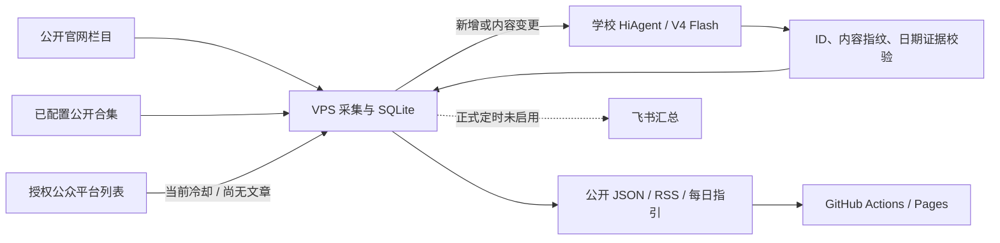

# 北理消息站 · bit-student-feed

由 VPS 采集北理工公开官网和已获授权的公众号列表，用学校 DeepSeek V4 Flash 分拣新增消息，输出网页、RSS 和每日活动指引。所有采集、去重、来源审计、模型校验及发送记录共用一套 Python/SQLite 流水线。

这是非官方学生项目。当前覆盖范围以页面“来源与覆盖”和公开 `sources.json` 为准，不能把官网栏目、公众号候选名单或扫码成功当作全校公众号已经接通。系统不读取使用者本机微信、聊天数据库或浏览器登录配置。

## 已核对状态

以下为 2026-11-09 的施工验收记录，最新运行结果以来源状态和任务日志为准。

| 环节 | 已核对结果 | 尚未完成 |
| --- | --- | --- |
| VPS 官网采集 | 北理就业公开栏目一轮 2,261 条、学院等官网一轮 1,035 条；近 90 天公开导出 1,965 条 | 部分来源失败、分页未穷尽；这些计数不代表公众号文章数或全历史 |
| 公众号 | 用户授权 VPS 扫码登录成功，账号数 1；搜索“北理就业”返回 `ret=0` | 首次文章列表返回 `ret=200013`、0 条，已停止并持久冷却 30 分钟 |
| 公开合集 | 已有适配器 | 尚未找到并配置北理就业合集，当前未接通 |
| 学校模型 | “学生服务”v1.1.0，DeepSeek-V4-Flash 正式版-260731；VPS 经 HiAgent V2 streaming 完成 3 条分拣、1 次请求并校验入库 | 本批通过校验的可参加活动为 0，暂不自动扩大批次；未分拣文章继续明确标注 |
| 飞书 | 卡片及纯文本 F2 测试均返回 HTTP 200 / `code=0` | 用户尚未确认看见；正式定时关闭 |
| GitHub | 公开仓库已有初稿提交 `9887bde`；Pages Source=Actions 和来源变量已保存 | Pages 网站部署与访问尚待验收 |

VPS 日更 timer 已启用，时间为北京时间每天 07:50；GitHub Actions 计划 08:20 发布公开结果，调度可能延迟。飞书拟在每周四、周日 12:00 汇总，接收核对完成后才启用正式发送。

## 订阅与阅读

计划入口：[GitHub Pages](https://lankerr.github.io/bit-student-feed/)（目前待部署验收）。发布后可订阅 `feed.xml` 查看全部已收录消息，`activities.xml` 查看通过日期与来源校验的可参加活动；`daily.md` 提供当日指引。

网页分别显示来源采集时间、页面生成时间、实际模型和正文状态。缺少发布日期证据的文章标“首次收录”；活动时间另列，不用活动开始日冒充发布日期。摘要或标题分拣不等于全文核验，报名条件和临时变更仍需打开原文确认。

## 数据怎样流动



VPS 当前数据使用全新的 `/var/lib/bitfeed-live`，不混入旧个人缓存。学校 API key、公众平台会话和飞书 webhook 留在服务端私密配置，GitHub 和静态网站只读取公开成品。学校智能体负责分拣，采集、定时、去重和导出由 VPS 负责。

原桌面订阅助手 exe 未修改；当前交付是独立的服务器流水线和订阅网站。

并行开发并入的 `site_sources.py`、`collect_site_feed.py` 和 `site_sources.yaml` 保留为手动公开来源查漏工具。它包含30个官网栏目和4个搜狗关键词；搜狗结果仅是搜索发现，临时链接和日期仍需核验。`sites-daily.yml` 仅手动运行并保存原始产物，生产定时统一由 VPS 执行，GitHub Pages 只发布通过校验的公开成品，避免两套任务互相覆盖。

[阅读91项公众号历史候选清单](docs/wechat-candidates.md)。名单用于逐号查漏，不表示使用者的实际关注列表。

## 本地验证

需要 Python 3.11 或以上；公开官网采集无需个人微信或学校 token。

```sh
python -m pip install .
python -m unittest discover -s tests -v
python -m bitfeed --data ./data server-daily --career-pages 1 --web-pages 1 --output dist
python -m http.server 18881 --directory dist
```

这条示例限制采集页数，不能用来证明来源完整。未配置模型时仍生成公开消息，分类保留“待分拣”；接口失败保留已有结果。不要把服务端会话或生产密钥复制到本地演示目录。

运维见 [部署说明](docs/deployment.md)，学校请求协议及预算见 [学校接口](docs/school-token.md)，公众号路线和完整性证据见 [订阅调查](docs/subscription-research.md)。
