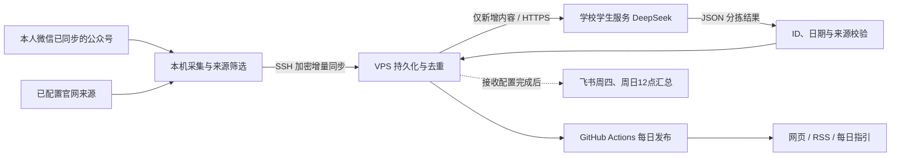

# 北理消息站 · bit-student-feed

把选定的公众号与官网公开通知汇总成每日网页、RSS 和活动指引。学校 DeepSeek 负责语义分拣，VPS 保存增量与结果，GitHub Pages 发布静态订阅入口。

这是非官方学生项目。仅覆盖已同步并选定的来源；微信桌面端离线时，公众号新增采集会延后。当前学校 API 密钥尚未配置，文章显示“待分拣”，不会冒充已经完成 AI 推荐。

## 使用

打开发布后的网页查看全部新消息；通过“优先关注”“临近截止”排序。可订阅 `feed.xml`（全部消息）或 `activities.xml`（通过日期和来源核验的活动）。`daily.md` 是当天指引。网页会显示真实来源同步时间，避免把页面重新生成当成微信已经更新。

部署入口：<https://lankerr.github.io/bit-student-feed/>（须完成 Pages 部署后才可访问）。

## 数据怎样流动



GitHub Pages 只托管公开内容。学校 token、微信密钥和飞书 webhook 都留在服务端私密配置，不进入浏览器、仓库或公开构建日志。学校登录 cookie 也不用于服务器自动化。

## 本机验证

需要 Python 3.11 或以上。

```sh
python -m pip install .
python -m unittest discover -s tests -v
python -m bitfeed import /path/to/public-feed.json
python -m bitfeed export --output dist
python -m http.server 18881 --directory dist
```

输入是 `{articles:[...]}`。每条只需 `title,url,source,published_at`；可选 `digest,body`。`group,ts,date` 兼容旧采集输出。仅接受微信公开文章和 `bit.edu.cn` 域名，不接受私聊、账号密钥或任意外链。

## 学校 token 与每日更新

详见 [学校接口配置](docs/school-token.md) 和 [部署与运维](docs/deployment.md)。

默认 VPS 每日北京时间 07:50 分拣并导出，GitHub Actions 08:20 拉取公开结果。Actions 的定时执行可能延迟。没有密钥时仍更新新消息，分类保留为待分拣；平台不可用时不调用付费备用模型。

每篇文章以内容指纹缓存，只有新增、正文变化或提示词版本变化才需要重新分拣。默认每批20篇、每日最多20次请求，失败请求也计入预算。实际 token 费用及额度以学校平台为准，本项目不承诺无限免费。

## 当前边界

- 微信采集器需要运行在本人设备，且微信已同步对应公众号。VPS 或学校智能体不能代替微信账号同步所有公众号。
- 仓库包含通用导入、分拣、校验、导出、网页和飞书发送组件；当前设备的数据库路径、来源白名单与 SSH 密钥不公开。
- 飞书已实现测试/正式隔离和持久化去重。群 webhook 尚待接入，正式定时发送未启用。
- 原桌面可执行文件尚未替换；当前交付是独立的数据流水线和订阅网站。
- 报名资格、名额、临时调整请打开原文核对。活动回顾不会进入可参加活动；缺少日期证据时标待核验。

## 站点与公众号搜索来源（2026-11-09 并入，来自 bit-feed 工程）

- `bitfeed/site_sources.py` + `config/site_sources.yaml`：34 个**免授权**来源
  - 30 个 bit.edu.cn 二级单位官网栏目（20 个单位，静态页解析）
  - 4 个搜狗微信搜索通道（账号名等效订阅：北理就业 / i北理 / 北理研会 + 选调关键词）
- `collect_site_feed.py` 产出 `site-data/site-feed.json`（schema 与 public-feed 一致，kind=site/mp-search）
- 工作流 `sites-daily.yml`：每日 08:00（北京）采集并提交，先于 daily-pages 构建
- 采集自 [rachelos/we-mp-rss] 之外的自研解析器；we-mp-rss 评估结论：默认模式仍依赖闭源 WeRSS/weread 上游，未采用
